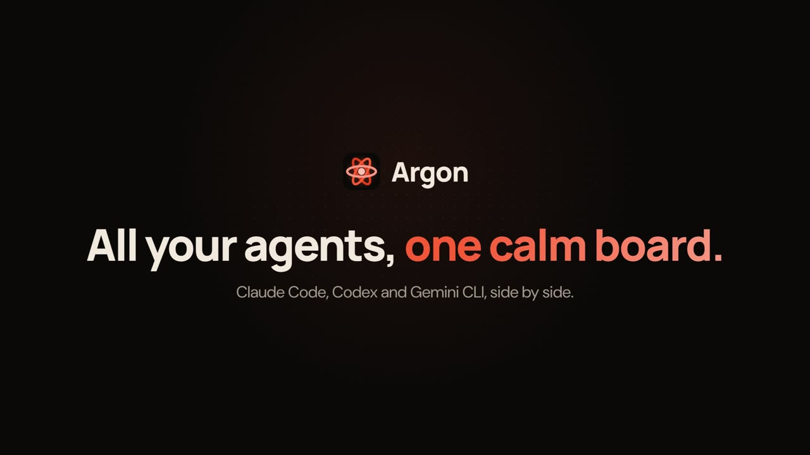

# Argon Website

The website for Argon, a Windows command deck for running coding agents side by side.
Static HTML, CSS and JS, deployed with GitHub Pages (same setup as the Chlorine site).

[](https://ophidianp.github.io/argon/#watch)

The launch video is [`assets/video/argon-launch.mp4`](assets/video/argon-launch.mp4); it plays on the home page under **Watch it work**.

## Pages
- **Home** — `index.html` (with the launch video)
- **Features** — `features.html`
- **Download** — `download.html` (the Windows installer, with a small link to the source)
- **404** — `404.html`

Shared assets: `assets/site.css` (the Mouse 33 design: floating header, scroll reveals, pinned feature
stage, cards and pill buttons, in Argon's ember accent; light and dark with a toggle) and `assets/site.js`
(theme toggle, header, menu, first-visit preloader, FAQ animation, feature stage). `favicon.svg`, `apple-touch-icon.png` and `og.png` sit at the root.

## Logo
The "argon" wordmark is drawn by `brand/argon_logo.py`: a flat rectangular nib swept along Bezier
centrelines, unioned into one piece and slanted 44°, the same technique as the Mouse 33 logo
(`brand/logo_gen.py`). `python -I brand/make_assets.py` rewrites the logo files and the icons, and stamps
the wordmark into the `<symbol id="argon">` of every page. `python -I brand/preview.py out.png` renders it.

Live at https://ophidianp.github.io/argon/ (deployed from the `argon-website` branch).

## Downloads
Every download button links to
`https://github.com/ophidianp/argon/releases/latest/download/Argon-Setup.exe`. Each release uploads a copy
of its installer under that fixed name (next to `Argon-<version>-setup.exe`, its `.sig` and `latest.yml`),
so the site never needs a version bump to download the newest one. The version shown on the download page and
the home page (`1.0.6`) is text: update it with each release.

## Preview locally
```
python -m http.server 8080
```
then open http://localhost:8080.
