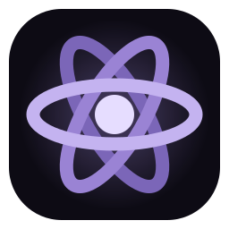
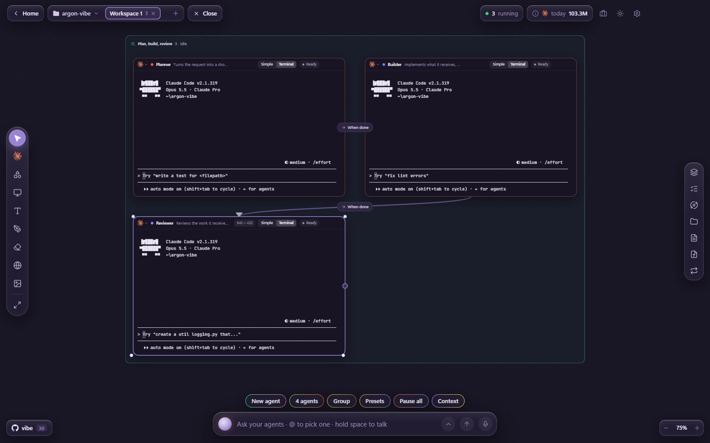
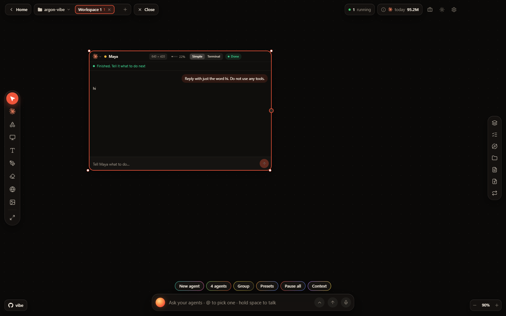
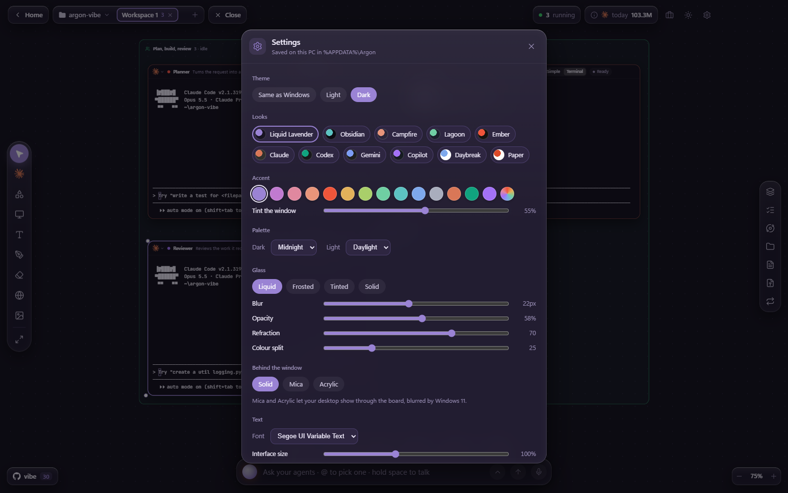
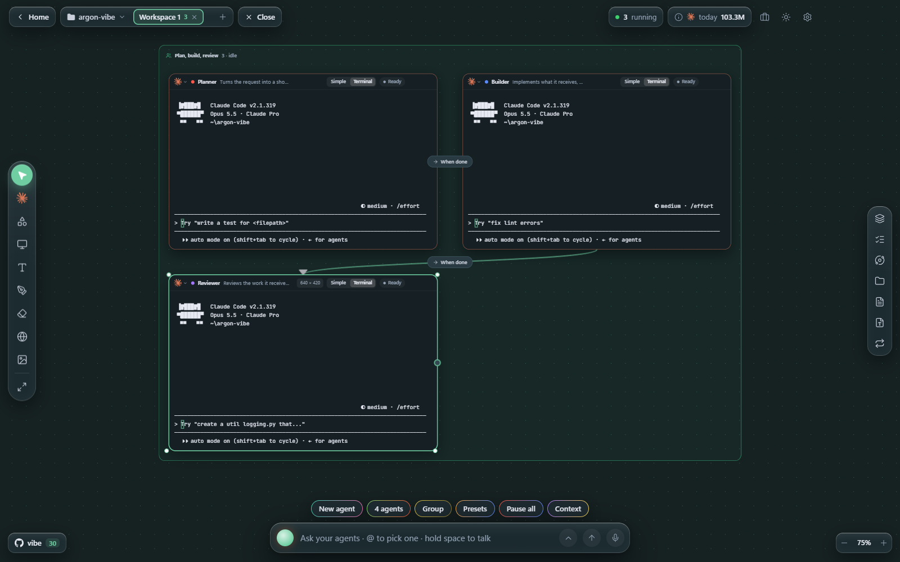
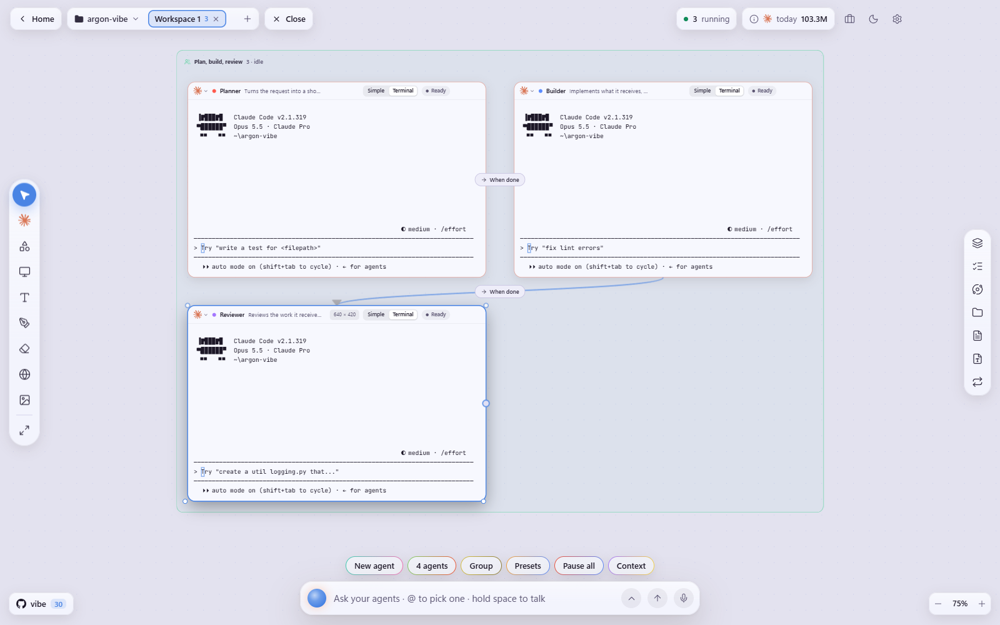

<p align="center">
  
</p>

<h1 align="center">Argon</h1>

<p align="center"><b>Your coding agents, working together, on one board. For Windows.</b></p>

<p align="center">
  <a href="LICENSE"></a>
  
  
</p>

<p align="center">
  
</p>

Argon puts the coding agents you already use (Claude Code, Codex, Gemini CLI and more) on one
infinite canvas. Every console is a real terminal running the real CLI, with your own sign-in.
Agents form teams, hand their work to one another along wires, and you watch all of it at once:
who is working, who needs you, how full each one's memory is.

Not at home in a terminal? Any agent can switch to a plain conversation with buttons for its
questions. The real terminal keeps running underneath, one click away.

## Quick start

You need [Node.js 24+](https://nodejs.org) and at least one agent CLI, for example Claude Code:

```powershell
irm https://claude.ai/install.ps1 | iex
```

Then:

```powershell
git clone https://github.com/ophidianp/argon
cd argon
npm install
npm start
```

Open a project folder, pick **Presets → Plan, build, review**, type a job into the ask bar, and the
planner hands its plan to the builder, which hands its work to the reviewer.

To build an installer: `npm run dist` (writes `release\Argon Setup *.exe`).

## Teams that work together

- **Presets**: Plan → Build → Review, Build → Review, Fix → Test, Research → Write, or a lead that
  brings helpers onto the board when a job splits into parts. Save your own mix as a preset.
- **Wires** carry the work: when an agent finishes, what it did goes to the next one with its role.
- **One ask bar** for everyone: `@Maya fix the failing test` goes to one agent, a plain message to
  the team.
- **Status at a glance**: Working, Needs you, Done, with a notification when you are in another window.
- **Memory meter**: each Claude shows how full its context is and what fills it.
- **Loops** repeat an instruction on a schedule, when an agent goes idle, or when it finishes.
- **More on the board**: code and document cards, notes, a kanban, diagrams of the repo, the dev
  server in a web tile, a git panel, a mission map of every agent.

<p align="center">
  
</p>

## Make it yours

Settings → **Appearance**:

- **Looks** in one click: Liquid Lavender, Obsidian, Campfire, Lagoon, Ember, Claude, Codex, Gemini,
  Copilot, Daybreak, Paper.
- **Accent**: fourteen colours or any colour you pick. It tints the whole window, the terminals'
  cursor and selection, and even the taskbar icon.
- **Palettes** for day and night, chosen separately.
- **Liquid glass**: the bars and menus bend what is behind them at their rim, with a slight colour
  split and a glare that follows the mouse. Or Frosted, Tinted, Solid; blur, opacity and refraction
  are yours to tune.
- **Mica or Acrylic** behind the window on Windows 11.
- **Font, interface size and animations** (springs and glides, or none).

<p align="center">
  
</p>

<table>
  <tr>
    <td width="50%"></td>
    <td width="50%"></td>
  </tr>
</table>

## Keyboard

| Key                             | What it does                                    |
| ------------------------------- | ----------------------------------------------- |
| Backspace or Delete             | Close what is selected, consoles included       |
| Ctrl+Z                          | Bring back what was just closed                 |
| Ctrl+0                          | Fit the whole board in view                     |
| Esc                             | Leave the current tool, menu or panel           |
| Hold Space                      | Dictate into the ask bar (not while typing)     |
| Shift- or Ctrl-click            | Select several things                           |
| Double-click a console's header | Show it at 100%                                 |
| Right-click                     | A menu for the board or for what is under it    |

## How it works

A small local server (Node, `node-pty`) runs each agent in a real Windows PowerShell terminal and
streams it to the board (React, React Flow, xterm.js) inside an Electron window. Agent status comes
from Claude Code's own hooks and its transcript, so Argon knows when an agent is thinking, waiting
on you, or done. A lead brings in helpers through a local MCP server. Nothing leaves your PC except
what your agents themselves send.

Your boards, loops and settings are saved in `%APPDATA%\Argon`. Set `ARGON_DATA` to run a separate
board, `ARGON_SHELL` to use PowerShell 7 (`pwsh.exe`) instead of Windows PowerShell.

## License

© 2026 Pavan Nemani. All rights reserved. Argon is built on vibeboard, © 2026 Riccardo Niccolò Agosti, used under the MIT License. See [LICENSE](LICENSE).
