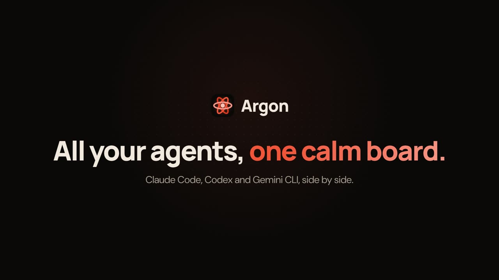

# Argon Website

The website for Argon, a Windows command deck for running coding agents side by side.
Static HTML, CSS and JS, deployed with GitHub Pages (same setup as the Chlorine site).

[](https://ophidianp.github.io/argon/#watch)

The launch video is [`assets/video/argon-launch.mp4`](assets/video/argon-launch.mp4); it plays on the home page under **Watch it work**.

## Pages
- **Home** — `index.html` (live board animation + four interactive demos)
- **Features** — `features.html`
- **Download** — `download.html` (the Windows installer, with a small link to the source)
- **Transparency** — `transparency.html`
- **404** — `404.html`

Shared assets: `assets/site.css` (styles and motion), `assets/site.js` (theme, accent
personalization, navigation, scroll reveals and the demos) and `assets/argon-icon.svg`.

Live at https://ophidianp.github.io/argon/ (deployed from the `argon-website` branch).

## Downloads
Every download button links to
`https://github.com/ophidianp/argon/releases/latest/download/Argon-Setup.exe`. Each release uploads a copy
of its installer under that fixed name (next to `Argon-<version>-setup.exe`, its `.sig` and `latest.yml`),
so the site never needs a version bump to download the newest one. The version shown on the download page and
the home page (`1.0.1`) is text: update it with each release.

## Preview locally
```
python -m http.server 8080
```
then open http://localhost:8080.
